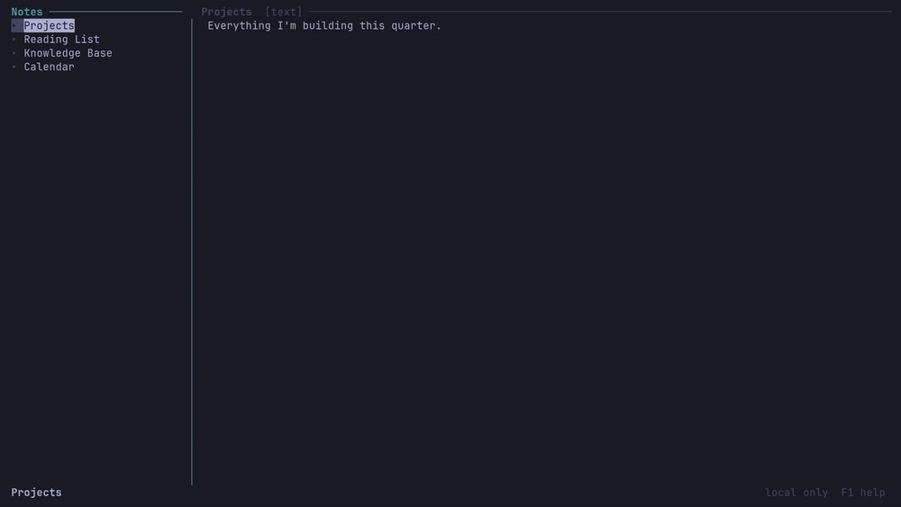
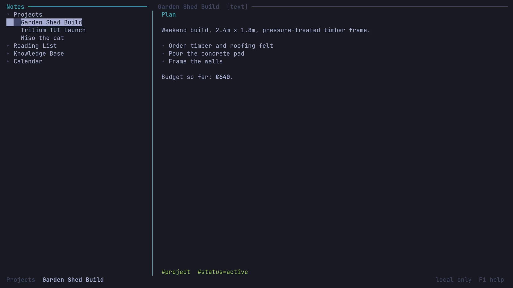
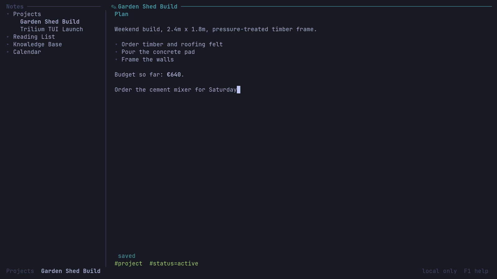
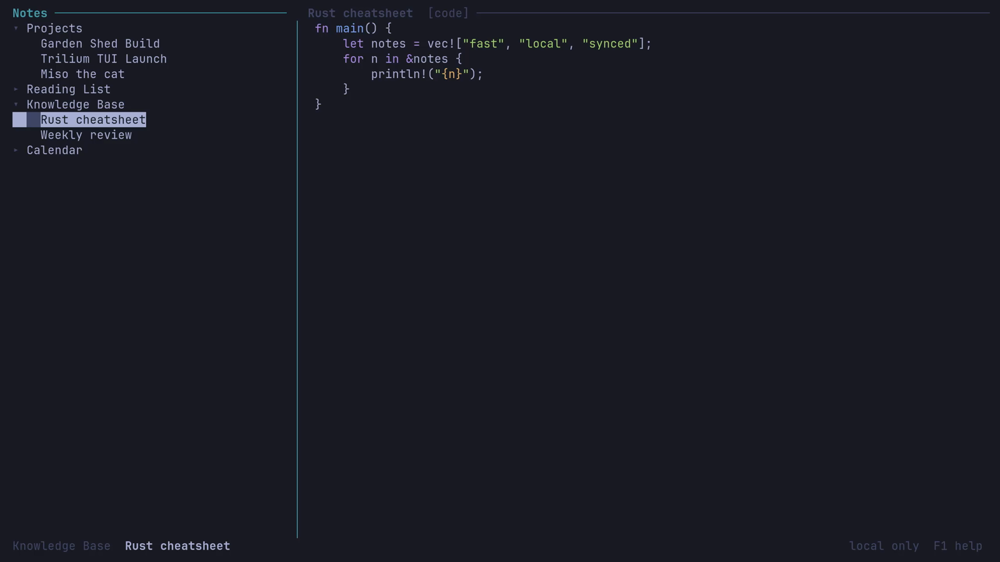
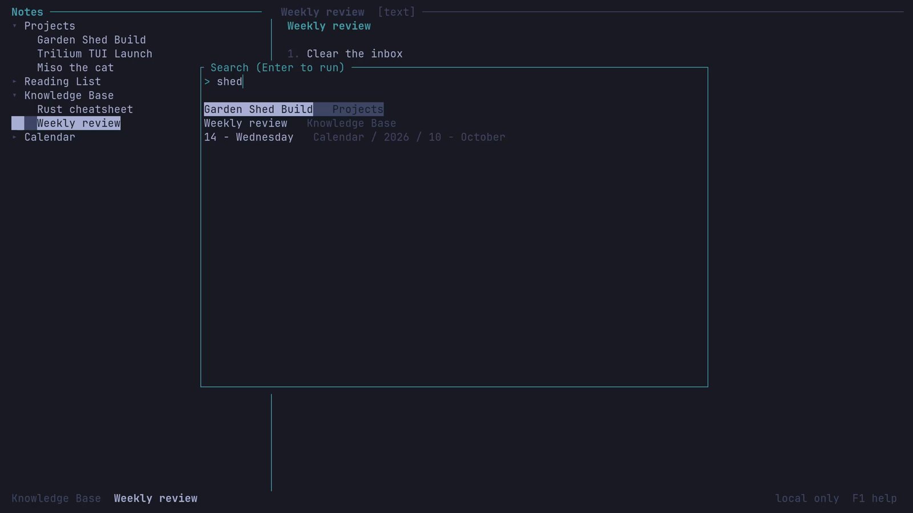
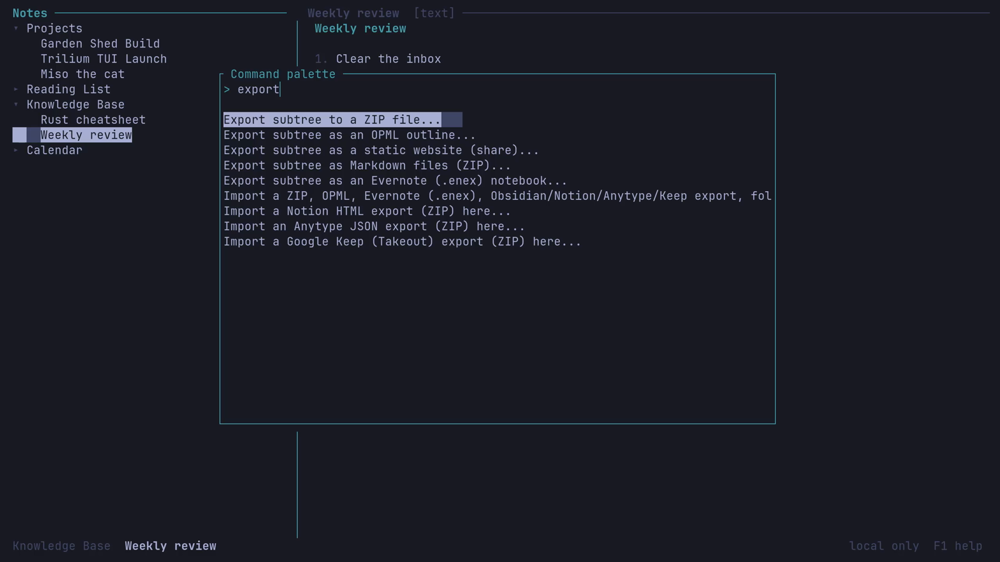
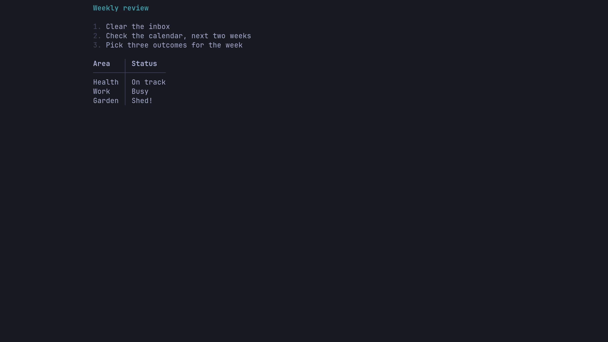
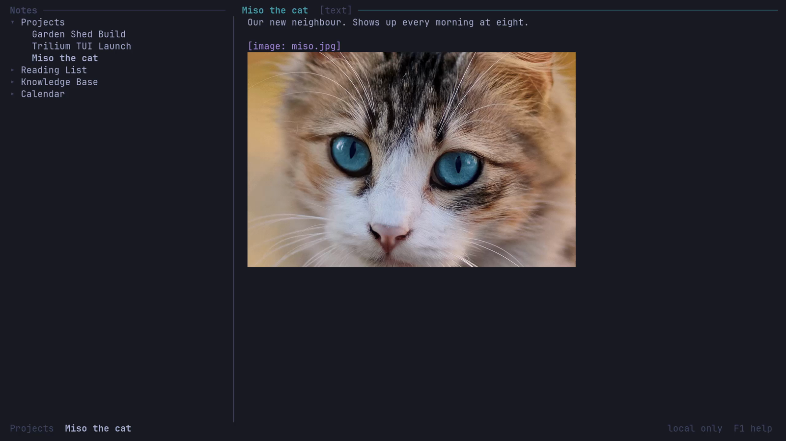
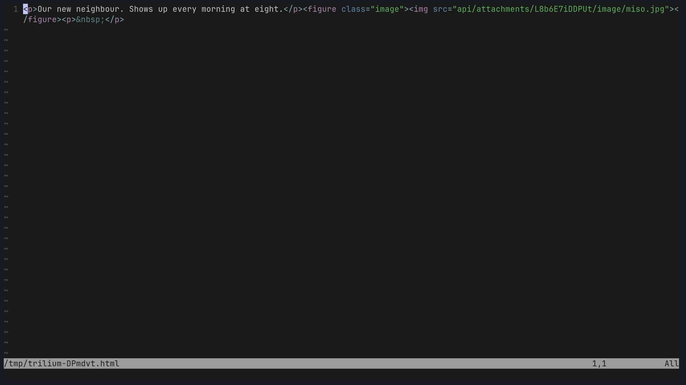

# trilium-tui

**Your Trilium Next notes, in the terminal. Fast, offline-first, and it syncs with your server.**

<p align="center">
  
</p>
<p align="center"><a href="docs/media/demo.mp4">Watch the demo as a video (MP4, 85 s, with key hints)</a></p>

trilium-tui keeps a **local copy** of your notes and talks to your Trilium server in the background, using the same sync protocol as the official desktop app. Every keystroke is handled locally, so the interface never waits on the network. No server? It works fully offline too.

It ships two programs: `trilium-tui` (the interface) and `trilium-cli` (the same notes from scripts and pipes, with `--json` everywhere).

## Why use it

- **Instant.** Browse, search and edit against a local SQLite database. Sync happens in the background.
- **Edit like a document, not like HTML.** Press `e` and edit formatted text right in the note pane: no tags on screen, bold/italic/code, lists, tables, links to other notes, pictures. Only the paragraph you touch is rewritten; the rest of the note is saved byte for byte. And when you want full control, edit the stored source too: `Ctrl+e` opens it in the built-in editor, `Shift+E` in your own `$EDITOR`. Nothing in a note is out of reach.
- **Safe with real data.** Writes copy Trilium's own bookkeeping (revisions, hashes, entity changes) and were checked against a real Trilium v0.106.0 server. A daily backup is made automatically, and unsaved text is kept in `lost-edits/` if a save ever fails.
- **Trilium's search, unchanged.** `#label`, `~relation.title`, `note.title *=* x`, `orderBy`: the full query syntax.
- **Bring your notes with you.** Import Obsidian, Notion, Anytype, Google Keep, Evernote and OPML. Export to Trilium ZIP, Markdown, OPML, Evernote, or a static website.
- **Encrypted notes work.** Protected notes use Trilium's own encryption and stay compatible with the web app.
- **Scriptable.** `trilium-cli` can search, read, append, export and import from a shell, with `--json` output.

## Install

You need a Rust toolchain (1.85 or newer, edition 2024). Prebuilt binaries are not published yet.

```sh
git clone https://github.com/en3r0/trilium-tui
cd trilium-tui
packaging/install.sh
```

This builds a release binary and installs `trilium-tui` and `trilium-cli` into `~/.local/bin`, plus shell completions and a desktop launcher entry. It needs no root and does not touch your Hyprland config (it prints an optional keybinding). Make sure `~/.local/bin` is on your `PATH`.

Arch users can instead run `makepkg -si` in `packaging/`. Prefer to build by hand? `cargo build --release` puts both binaries in `target/release/`.

## Get started in a minute

**A. You already use a Trilium server**

```sh
TRILIUM_PASSWORD='your-password' trilium-cli sync http://your-server:8080
trilium-tui
```

The first command downloads a copy of your notes to `~/.local/share/trilium-tui/default.db`. After that the TUI syncs on its own, and `Ctrl+R` syncs on demand. Because edits are pushed back to the server, take a Trilium backup before your first sync if your notes matter to you.

**B. Just try it, no server**

```sh
trilium-tui --new
```

This creates an empty local notebook. You can connect it to a server later.

Press **`F1`** inside the app for the full key list.

## The keys you need first

| Key | Does |
|---|---|
| `↑` `↓` `→` `←` | move in the tree, expand, collapse |
| `Ctrl+J` | jump to a note by title (fuzzy) |
| `Ctrl+S` or `/` | search titles and content |
| `:` or `Ctrl+Shift+J` | command palette (import, export, protect, sync, ...) |
| `e` | edit the open note in place; `Ctrl+S` saves, `Esc` closes |
| `Ctrl+e` | edit the stored source (HTML, Markdown or code) in the built-in editor |
| `E` (Shift+E) | edit the source in your `$EDITOR` (nvim, helix, ...) |
| `Alt+P` / `Alt+V` | while editing: insert a picture from a file or the clipboard / show pictures inline |
| `a` / `c` | append a line to the note / capture a line into today's journal |
| `t` | open today's journal note |
| `Ctrl+T` / `Ctrl+W` | new / close tab |
| `Z` or `F11` | zen mode: just the text |
| `F1` | all keys |
| `q` | quit |

Keys follow the Trilium web app wherever a terminal allows. Rebind them in `~/.config/trilium-tui/keys.json`.

## A look around

| | |
|---|---|
|  **Read.** Notes are rendered for the terminal: lists, tables, to-do items, quotes, images. |  **Edit in place.** Formatted text, no tags, with a hint bar for the keys. |
|  **Code notes** are highlighted in your terminal's own palette (it follows the Omarchy theme). |  **Search** with Trilium's query syntax, results with their path. |
|  **Command palette** for everything else: import, export, sync, protect, journal. |  **Zen mode** hides all chrome and centres the text. |
|  **Pictures** are attached with `Alt+P` and shown inline (sixel, kitty or iTerm2 graphics where the terminal supports them, half-blocks elsewhere). |  **Source editing** with `Shift+E` opens the stored HTML in your `$EDITOR`; saving it updates the note. |

(Demo screenshots use a made-up notebook, not real data. The cat photo is ["Tabby cat with blue eyes"](https://commons.wikimedia.org/wiki/File:Tabby_cat_with_blue_eyes-3336579.jpg) from Wikimedia Commons, released under CC0 and cropped.)

## Use it from scripts

```sh
trilium-cli search '#project'              # find notes with Trilium's query syntax
trilium-cli get <noteId>                   # print a note
trilium-cli daily --append "Called the plumber"   # add to today's journal
echo "buy timber" | trilium-cli append <noteId> -
trilium-cli export <noteId> out.md.zip --format markdown
trilium-cli import ~/Obsidian/MyVault.zip
trilium-cli search '#todo' --json | jq '.[].title'
```

`trilium-cli --help` lists every command; completions for bash, zsh and fish are installed by `install.sh`.

## Questions you might have

**Does it replace the Trilium server?** No. It is a client, like the desktop app. Run a server if you want sync between devices.

**Which Trilium versions work?** Released Trilium Next servers up to v0.106.0 (sync protocol 39) and the development branch (40). If a server's database is newer than what this build was tested against, the app opens read-only instead of risking your data.

**Can I use it without a server?** Yes: `trilium-tui --new`.

**Where is my data?** `~/.local/share/trilium-tui/default.db`, with daily backups next to it (`*.bak-DATE.db`, newest 7 kept). The file holds your sync secret, so it is created readable by you only.

**Which terminal should I use?** Any. For the best experience use one with the kitty keyboard protocol (foot, Alacritty, Kitty, Ghostty). Images use sixel/kitty/iTerm2 graphics where available and half-blocks elsewhere.

**What can't it do?** It cannot run Trilium's JavaScript notes (there is no browser in a terminal), and OneNote cannot be imported because it needs a Microsoft account. In the in-place editor you cannot yet add or remove table rows and columns, or resize pictures; use the source editor (`Ctrl+e`) for those. The full list is in the [reference](docs/FEATURES.md).

**Something looks wrong on my data.** Please open an issue. Include the Trilium server version and what you pressed.

## More

- [Full feature list, importers, protected notes, safety details](docs/FEATURES.md)
- [Protocol notes and the verification log](docs/P0-findings.md)

## License

AGPL-3.0-or-later. The database schema and sync behaviour are derived from [Trilium Next](https://github.com/TriliumNext/Trilium) (AGPL-3.0-or-later); see `LICENSE`. The static-site export bundles Trilium Next's share theme and Boxicons (CC BY 4.0).
